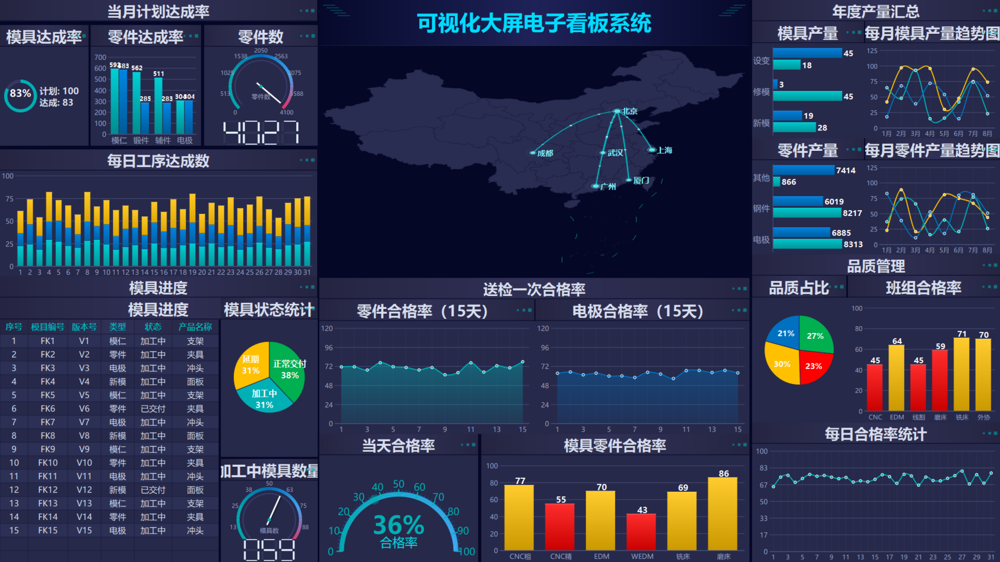

# FactoryDashboard

> 基于 **Qt 6** 的工业数据可视化大屏系统
> 20+ 自绘图表 + 中国地图飞线动画



---

## 项目亮点

- **零第三方依赖** —— 只依赖 Qt 6 Widgets，20+ 图表全部 `QPainter` 自绘
- **已在真机编译运行验证** —— Qt 6.8.3 + MinGW 13.1 构建零错误零警告，截图取自程序真实渲染输出
- **一份代码适配全部分辨率** —— 设计分辨率 1920×1080 + 离屏渲染等比缩放，图形绝不变形
- **完整行政区划地图** —— 34 个省级行政区 + 国界线，含飞线流动光点与节点涟漪动画
- **设计稿量化还原** —— 配色与布局坐标均由脚本从参考图逐像素/逐边界提取

## 快速开始

```bash
# 需要 Qt 6.2+ 与 CMake 3.16+（实测 Qt 6.8.3 + MinGW 13.1 + Ninja）
cmake -B build -DCMAKE_PREFIX_PATH="C:/Qt/6.8.3/mingw_64" -G Ninja
cmake --build build
./build/FactoryDashboard.exe
```

程序默认全屏运行。快捷键：

| 按键 | 功能 |
|---|---|
| `Esc` | 退出 |
| `F11` | 全屏 / 窗口切换 |
| `F` | 冻结地图动画（便于截图） |
| `R` | 强制重建离屏缓存 |

## 文档

- **[技术文档](docs/技术文档.md)** —— 架构设计、核心机制、踩坑记录、面试问答
- **[从零复刻步骤](docs/从零复刻步骤.md)** —— 11 个阶段的施工顺序表，每个阶段的文件变动与验证方法
- **[面试问答](docs/面试问答.md)** —— 技术选型答辩要点

## 目录结构

```
src/
├── main.cpp程序入口、高分屏策略
├── DashboardWidget.{h,cpp}主看板：三栏布局 + 20+ 面板装配
├── core/
│   ├── Theme.{h,cpp}             配色 / 字体 / 通用绘制助手
│   └── ScaledCanvas.{h,cpp}      等比缩放 + 离屏缓存
├── data/
│   ├── DashboardData.{h,cpp}     数据模型 + 模拟数据源
│   └── china_map_data.h          自动生成的地图坐标表
└── widgets/
    ├── ChartWidgets*             分组柱/堆叠柱/横条/折线/饼图/进度环/数码管
    ├── GaugeWidgets              270° 仪表 + 180° 半圆盘
    ├── ChinaMapWidget            地图 + 飞线动画
    └── PanelWidgets              标题条 + 文本区 + 数据表格

tools/                            配套 Python 工具链
├── gen_map_data.py               GeoJSON → 紧凑 C++ 坐标表
├── preview_map.py                地图数据离线验证
├── preview_dashboard.py          整屏离线预渲染
└── analyze_*.py / scale_layout.py 设计稿量化分析
```

## 设计还原方法

本项目的布局与配色不是「看着设计稿估」的，而是用脚本量化提取的：

```bash
python tools/analyze_layout.py    # 提取三栏边界比例
python tools/analyze_rows.py      # 精确定位每个面板的上下边界
python tools/scale_layout.py      # 换算到 1920×1080 设计坐标系
```

配色同样逐像素采样：统计参考图各区域的高饱和度像素即可得到准确色值。

## 修改指南

| 想做什么 | 改哪里 |
|---|---|
| 换配色 | `src/core/Theme.h` 的色板函数（全项目色值集中于此） |
| 加图表面板 | `DashboardWidget.cpp` 的 `buildPanels()` + `applyData()` |
| 加图表类型 | 新建 `QWidget` 子类实现 `paintEvent`，参考 `GroupedBarChart` |
| 接入真实后端 | 替换 `DataSimulator`，只需发 `dataUpdated()` 信号 |
| 调整地图精度 | 重跑 `gen_map_data.py`，改最后的容差参数 |

## 环境

Qt 6.2+ / CMake 3.16+ / C++17 / MSVC 2019+ 或 GCC 9+

## 许可

代码可自由用于学习与求职展示。地图数据来源为公开的行政区划边界数据，
渲染完整遵循国家关于行政区划与国界线的规范要求。